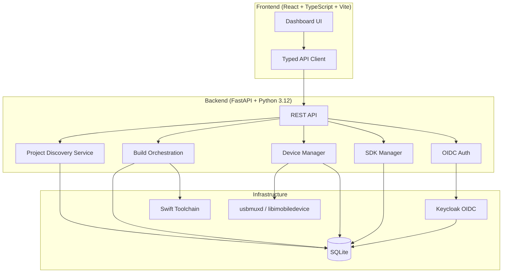

# tensor-workbench-ryan-vo — Ryan Vo

> Work in progress. This checkpoint may be incomplete or fail tests. See PLAN.md and STATUS.md before use.


> Ryan Vo | AI & Machine Learning

Cross-platform Xcode replacement: build and deploy iOS apps with SwiftPM on Linux, Windows, macOS.

## Problem

iOS development traditionally requires macOS and Xcode. Developers on Linux, Windows (WSL), or CI/CD pipelines cannot natively build, sign, and deploy iOS applications. Existing tools like xtool have made progress but suffer from reliability issues: device connection hangs ("stuck on Connecting"), missing actool wrappers, @Observable macro failures on Linux, 2FA authentication problems, and missing capability support (WeatherKit, etc.).

## Solution

tensor-workbench provides a **web-based dashboard** and **REST API** for managing SwiftPM-based iOS projects across platforms:

- **Project Discovery**: Automatically scans workspace for `Package.swift` files
- **Build Orchestration**: Triggers `swift build` with target selection (device/simulator) and streams logs
- **Device Management**: Detects connected iOS devices via usbmuxd, deploys .app bundles
- **SDK Management**: Downloads and manages Darwin SDKs for cross-compilation
- **Apple Authentication**: OIDC via Keycloak with Apple ID identity broker for App Store Connect API access

## Architecture



## Quick Start

### Prerequisites

- Docker 24+ and Docker Compose
- Swift 5.9+ toolchain installed on host (for native builds)
- For device deployment: usbmuxd, libimobiledevice, ideviceinstaller

### Development

```bash
# Clone and enter directory
cd tensor-workbench-ryan-vo

# Copy environment template
cp .env.example .env

# Start all services
docker compose up --build

# In another terminal, run backend tests
cd backend && .venv/bin/pytest

# Run frontend tests
cd frontend && npm test
```

Services will be available at:
- **Frontend**: http://localhost:5173
- **Backend API**: http://localhost:8000/api
- **API Docs**: http://localhost:8000/docs
- **Keycloak Admin**: http://localhost:8080 (admin/admin)

### Local Development (without Docker)

```bash
# Backend
cd backend
python -m venv .venv
.venv/bin/pip install -r requirements.txt
.venv/bin/python -m pytest
.venv/bin/uvicorn app.main:app --reload --host 0.0.0.0 --port 8000

# Frontend (separate terminal)
cd frontend
npm install
npm run dev
```

## Workflows

### 1. Discover and Build a SwiftPM Project

```bash
# 1. Place your SwiftPM project in ./workspace/MyApp/
# 2. Open dashboard at http://localhost:5173
# 3. Click "Scan Workspace" to discover projects
# 4. Select project → choose target (device/simulator) → click Build
# 5. View real-time build logs via SSE
# 6. On success, .app bundle appears in artifacts
```

### 2. Deploy to Physical iOS Device

```bash
# 1. Connect iOS device via USB (WSL: usbipd bind)
# 2. Dashboard shows device in "Devices" tab
# 3. Trust device on iOS prompt
# 4. Select built .app → click Deploy
# 5. Monitor installation progress
```

### 3. Manage Darwin SDKs

```bash
# 1. Navigate to SDK Manager in dashboard
# 2. View installed SDKs (iOS 18.5, macOS 15, etc.)
# 3. Click "Install" to download new SDK from Apple
# 4. Select SDK version for builds
```

## API Reference

### Health & Version
| Method | Endpoint | Description |
|--------|----------|-------------|
| GET | `/api/health` | Health check with DB connectivity |
| GET | `/api/version` | Application version info |

### Projects
| Method | Endpoint | Description |
|--------|----------|-------------|
| GET | `/api/projects` | List projects (paginated, filterable) |
| GET | `/api/projects/{id}` | Get single project |
| POST | `/api/projects/scan` | Trigger workspace scan |

### Response Envelope
```json
{
  "projects": [...],
  "total": 42,
  "limit": 50,
  "offset": 0
}
```

### Project Object
```json
{
  "id": 1,
  "name": "MyApp",
  "path": "/workspace/MyApp",
  "package_name": "MyApp",
  "package_version": "1.0.0",
  "swift_tools_version": "5.9",
  "status": "valid",
  "targets": ["MyApp", "MyAppTests"],
  "dependencies": ["https://github.com/apple/swift-argument-parser"],
  "latest_build": {
    "id": 5,
    "target": "device",
    "configuration": "debug",
    "status": "success",
    "duration_seconds": 45.2
  },
  "created_at": "2024-01-15T10:30:00Z",
  "updated_at": "2024-01-15T10:30:00Z"
}
```

## Configuration

Environment variables (see `.env.example`):

| Variable | Description | Default |
|----------|-------------|---------|
| `DATABASE_URL` | SQLite database path | `sqlite+aiosqlite:///./data/tensor-workbench.db` |
| `WORKSPACE_ROOT` | Root directory to scan for projects | `/workspace` |
| `KEYCLOAK_URL` | Keycloak base URL | `http://localhost:8080` |
| `KEYCLOAK_REALM` | Keycloak realm name | `tensor-workbench` |
| `KEYCLOAK_CLIENT_SECRET` | Client secret for tensor-workbench client | Required |
| `DEMO_MODE` | Enable localhost-only demo login | `true` |
| `SWIFT_PATH` | Path to swift executable | `swift` |

## Security

- **Authentication**: OIDC authorization code flow with PKCE via Keycloak
- **Roles**: `admin` (full), `operator` (build/deploy), `viewer` (read-only)
- **Tokens**: Access tokens in memory only (SPA), HttpOnly cookies for backend sessions
- **Secrets**: Never committed; use `.env` file
- **Demo Mode**: Binds to localhost only; **refuses to start in production** (`ENVIRONMENT=production`)
- **TLS**: Required in production behind reverse proxy (nginx/Traefik)

### Apple Developer Integration

Keycloak configured with Apple ID identity broker:
1. Create Apple Services ID in Developer Portal
2. Configure Keycloak identity provider with Client ID/Secret
3. Users sign in with Apple ID → Keycloak → App Store Connect API access

## AI/ML Evaluation

This project includes a **domain-specific build analysis engine** that:

- Parses SwiftPM manifests to extract dependency graphs
- Analyzes build logs for error patterns (macro expansion failures, linking errors)
- Correlates build failures with known issues (e.g., @Observable on Linux Swift 6.2.3)

**Reproducible Baseline**:
```bash
# Run build analysis on sample projects
python -m backend.app.services.build_analyzer --workspace ./workspace
```

**Limitations**: No LLM integration in this version; analysis is rule-based. Future rounds will add opt-in LLM explanations for build failures.

## Development

### Running Tests

```bash
# Backend
cd backend
.venv/bin/pytest -v --cov=app

# Frontend
cd frontend
npm test
```

### Code Quality

```bash
# Backend linting
cd backend
.venv/bin/ruff check .
.venv/bin/mypy app

# Frontend linting
cd frontend
npm run lint
```

### Adding a Feature

1. Create feature branch
2. Update `feature-plan.json` with new feature
3. Implement backend API + tests
4. Implement frontend components + tests
5. Update `PLAN.md`, `CHANGELOG.md`
6. Run full test suite
7. Submit PR

## Deployment

### Production Checklist

- [ ] Set `ENVIRONMENT=production` in `.env`
- [ ] Generate strong `SECRET_KEY` and `KEYCLOAK_CLIENT_SECRET`
- [ ] Configure TLS reverse proxy (nginx + Let's Encrypt)
- [ ] Set up PostgreSQL for Keycloak (replace dev SQLite)
- [ ] Configure Apple ID identity broker in Keycloak
- [ ] Set up backup/restore for SQLite database
- [ ] Configure log aggregation

### Docker Production Build

```bash
docker compose -f compose.yaml -f compose.prod.yaml up --build -d
```

## Backup & Restore

```bash
# Backup database
cp data/tensor-workbench.db backups/tensor-workbench-$(date +%F).db

# Restore
cp backups/tensor-workbench-2024-01-15.db data/tensor-workbench.db
```

## Troubleshooting

| Issue | Solution |
|-------|----------|
| "actool not found" | Ensure Darwin SDK installed via SDK Manager; run `xtool sdk install` |
| Device stuck on "Connecting" | Check usbmuxd running; restart device; verify USB passthrough in WSL |
| @Observable macro errors | Use Swift 6.1 or 6.3+; avoid 6.2.3 on Linux |
| 2FA not arriving | Check Apple ID trusted devices; use Keycloak Apple broker instead |
| WeatherKit capability | Register capability via App Store Connect API (future round) |

## License

MIT License © Ryan Vo <ryandtvo@gmail.com>

## Changelog

See [CHANGELOG.md](CHANGELOG.md) for detailed changes.

---

**Author**: Ryan Vo (ryandtvo@gmail.com)  
**Repository**: https://github.com/A220man/tensor-workbench-ryan-vo